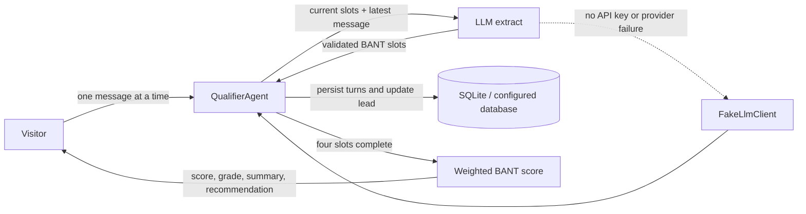

# Lead Qualifier Bot

Signal is a recruiter-ready conversational lead qualification demo built with Laravel 13, Vue 3, Inertia, and an optional Gemini extraction client. It interviews visitors one question at a time, captures four BANT signals, scores the lead from 0–100, assigns a grade, and recommends a next step.

## How the AI works



`QualifierAgent` owns the conversation: it asks only for the next missing signal and validates every extracted value before it can update a lead. `LlmClient` is the provider boundary. The included deterministic `FakeLlmClient` powers local demos and tests; `GeminiLlmClient` is selected only when `GEMINI_API_KEY` is set. Gemini calls have a 12-second timeout, and extraction/provider errors fall back to the deterministic client instead of interrupting the chat.

### Score weights

| Signal    | Maximum | Point bands                                                      |
| --------- | ------: | ---------------------------------------------------------------- |
| Need      |      30 | Clear active need: 30; casual browsing: 5; unknown: 0            |
| Budget    |      25 | $15k+: 25; $5k–$15k: 20; $1k–$5k: 12; under $1k: 5               |
| Authority |      25 | Decision-maker: 25; shared decision: 20; evaluator: 12           |
| Timeline  |      20 | Immediate: 20; within 3 months: 18; 3–6 months: 12; 6+ months: 6 |

Unknown values receive zero points. Grades are A (80–100), B (60–79), C (40–59), and D (0–39). The next-step recommendation is deterministic and based on the final grade.

## Run locally without an API key

Requirements: PHP 8.3+, Composer, Node.js 20+, and npm.

```bash
composer install
cp .env.example .env
php artisan key:generate
php artisan migrate --seed
npm install
```

Leave `GEMINI_API_KEY` empty. The application binds `FakeLlmClient` automatically and runs without Redis, a queue worker, a CRM, or external credentials.

Start the app in two terminals:

```bash
php artisan serve
```

```bash
npm run dev
```

Open <http://localhost:8000>. The suggested prompts demonstrate both an active project and a browsing-only lead. To enable Gemini extraction, set `GEMINI_API_KEY` in `.env`; `GEMINI_MODEL` defaults to `gemini-2.5-flash`.

## Demo data

`php artisan migrate --seed` creates three completed, fictional sample leads for **Northwind Labs**: grades A, B, and D. Their emails use the reserved `.example` domain. No login or demo credentials are needed. Visitor conversations are stored with opaque UUIDs and can be resumed in the same browser.

## Tests

```bash
php artisan test
```

The Pest feature suite binds `FakeLlmClient`, posts a guest conversation through the real endpoint, checks that need, budget, authority, and timeline are extracted and persisted, and verifies the score remains within 0–100. A high-budget decision-maker with a near-term launch earns grade A and a discovery-call recommendation. Additional coverage verifies fallback behavior when an LLM throws and retrieval of a public conversation without exposing the database ID.

The repository checks can also be run with:

```bash
composer lint:check
composer types:check
npm run check
npm run types:check
npm run build
```

## Architecture

- `app/Services/Leads/QualifierAgent.php` — one-question-at-a-time state machine, slot validation, persistence, and completion response.
- `app/Services/Leads/LeadScorer.php` — documented BANT weights, grade bands, concise summary, and next-step mapping.
- `app/Services/Llm/LlmClient.php` — provider interface; Fake and Gemini implementations live alongside it.
- `app/Models/Lead.php` and `ChatTurn.php` — lead state and an auditable conversation transcript, including extracted JSON on visitor turns.
- `resources/js/pages/Welcome.vue` — public chat, four-signal progress, resumable conversation, and final score card.

Public endpoints are `GET /`, `POST /chat`, and `GET /chat/{publicId}`. The chat write endpoint is rate-limited. The demo does not connect to a real CRM, process real patient data, take payments, or load advertising pixels.
